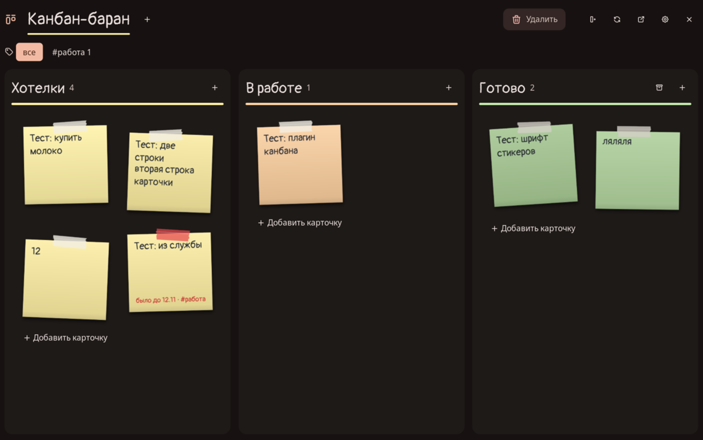

# noctalia-kanban

Канбан-доска для [Noctalia](https://noctalia.dev) (Wayland-оболочка) в виде
плагина `pvs/kanban`. Карточки нарисованы как бумажные стикеры: листок
с тенью, полоской скотча и рукописным шрифтом, каждый немного повёрнут. Доски
хранятся в markdown-файлах формата плагина
[Obsidian Kanban](https://github.com/mgmeyers/obsidian-kanban), так что любую
доску можно открыть и править в Obsidian, а история правок попадает в git
хранилища.



## Возможности

- **Панель-доска** (Win+K): колонки с листками, перетаскивание мышью между
  колонками и внутри колонки, правка по клику, корзина в шапке.
- **Несколько досок**: каждая доска — отдельный `.md` в папке досок; вкладки в
  шапке, новая доска — «+», переименование и удаление — клик по открытой вкладке
  (удаление — в корзину системы, `gio trash`).
- **Колонки**: добавить, переименовать, сдвинуть, удалить; колонка «готово»
  (`**Complete**` в Obsidian) отмечает свои карточки `[x]`. При 4+ колонках
  листки встают по одному в ряд, при 6+ уменьшаются.
- **Сроки** `@{ГГГГ-ММ-ДД}` — как в Obsidian Kanban: подпись на листке
  («до 20.11», «завтра», «сегодня!»), у просроченных красный скотч; в правке —
  «сегодня / завтра / +неделя / убрать».
- **Напоминания**: фоновая служба раз в 10 минут проверяет все доски и
  присылает уведомление о сроке сегодня или просрочке (раз в день на карточку).
- **Метки** `#тег` — подписью на листке и фильтром над колонками.
- **Цвет листка** — по колонке или выбранный вручную (кружки в правке).
- **Архив**: кнопка у колонки «готово» переносит карточки в раздел архива
  файла (`***` / `## Archive`), который Obsidian показывает в меню доски.
- **Значок на панели Noctalia**: число карточек «в работе», красный — есть
  просроченные; подсказка с разбивкой по колонкам; клик открывает доску.
- **Виджет рабочего стола**: карточки «в работе» мини-листками.
- **Лаунчер** `/kb текст` — добавить карточку в первую или выбранную колонку;
  там же поиск по карточкам доски.
- **Быстрое добавление без панели** (Win+Alt+K): текст из буфера обмена —
  карточкой в первую колонку.
- **Отмена** Ctrl+Z (до 50 шагов: удаление, перенос, правка, колонки).
- **Клавиатура**: стрелки — выбор листка, Enter — правка, Delete — удалить,
  `n` — новая карточка, `p` — помидор, `1`–`9` — в колонку N, Ctrl+F — поиск.
- **Поиск** по доске: несовпавшие листки тускнеют.
- **Помидор** 25 минут с карточки: обратный отсчёт на значке панели, правый
  клик — стоп, уведомление в конце.
- **Учёт времени**: сколько карточка лежит в колонке («3 дн.» на листке);
  по понедельникам — сводка: закрыто за неделю и что висит больше 5 дней.
- **Повторы** `#каждый-день`, `#каждую-неделю`, `#каждый-месяц`: закрыл — в
  первой колонке появилась следующая со сдвинутым сроком.
- **Лимит карточек в колонке**: «3/3» в заголовке, красный при превышении.
- **Чек-лист** в карточке (строки `- [ ]`): прогресс «2/5» на листке,
  переключатели в правке.
- **Ссылки** `[[Заметка]]` (открывает Obsidian) и `https://…` — скрепка на
  листке, кнопки в правке.
- **Скриншот на карточку** (Win+Ctrl+K): область экрана → `attachments/` +
  карточка `![[файл.png]]`, миниатюра на листке.
- **Приоритет** `!` / `!!` в начале текста: листок выше в колонке, булавка
  вместо скотча (оранжевая / красная).
- **Размер окна** — % от видимой области монитора (настройка) и кнопка «на
  весь экран».
- **Стикер на рабочий стол**: копия карточки стикером плагина
  [Noctes](https://github.com/RamonRemo/noctes) (если он установлен).
- Параллельная правка: пока панель открыта, файл раз в секунду сверяется с
  диском и перечитывается, если его поменял Obsidian или git.

## Требования

- Noctalia 5.4+ (plugin API 43).
- `sh`, `find`, `grep`, `mv`, `gio` (корзина), `xdg-open` (открыть в Obsidian).
- ImageMagick 7 (`magick`) — рисует повёрнутые листки картинками (в API 43 у
  элементов интерфейса нет поворота).
- Рукописный шрифт с кириллицей, по умолчанию
  [Pangolin](https://fonts.google.com/specimen/Pangolin) (OFL) в
  `~/.local/share/fonts/Pangolin-Regular.ttf`.
- Для Win+Alt+K — `wl-clipboard` (`wl-paste`), `notify-send`; для Win+Ctrl+K —
  `slurp`, `grim`; размер окна считается по `hyprctl monitors -j` (Hyprland).

## Установка

Локально, ссылкой на рабочую копию (правки `.luau` подхватываются на лету):

```sh
ln -s ~/Workspaces/Personal/noctalia-kanban/kanban ~/.local/share/noctalia/plugins/kanban
noctalia msg config-reload
noctalia msg plugins enable pvs/kanban
```

После переноса папки плагина Noctalia продолжает следить за старым путём —
нужен перезапуск Noctalia (или перелогин).

Или как источник плагинов (репозиторий с `catalog.toml` в корне):

```sh
noctalia msg plugins source add pvs-kanban path ~/Workspaces/Personal/noctalia-kanban
noctalia msg plugins enable pvs/kanban
```

### Значок на панели

`~/.config/noctalia/config.toml`:

```toml
[bar.default]
end = [ "media", "kanban", "tray", … ]

[widget.kanban]
type = "pvs/kanban:bar"
```

### Виджет рабочего стола

Редактор виджетов стола (Settings → Desktop → Widgets → Toggle Editor, или
`noctalia msg desktop-widgets-edit`) → добавить **Kanban**.

### Хоткеи Hyprland (Lua-конфиг)

```lua
hl.bind("SUPER + K",        hl.dsp.exec_cmd("noctalia msg plugin pvs/kanban:service all open"))
hl.bind("SUPER + ALT + K",  hl.dsp.exec_cmd(os.getenv("HOME") .. "/.config/hypr/scripts/kanban-clip.sh"))
hl.bind("SUPER + CTRL + K", hl.dsp.exec_cmd(os.getenv("HOME") .. "/.config/hypr/scripts/kanban-shot.sh"))
```

`extras/hyprland/kanban-clip.sh` (Win+Alt+K) и `kanban-shot.sh` (Win+Ctrl+K) —
положить или слинковать в `~/.config/hypr/scripts/`. Доску открывать через
службу (`… service all open`): она выбирает обычное окно или полноэкранное и
подгоняет размер.

## Управление

| Действие | Как |
| --- | --- |
| Открыть доску | Win+K, клик по значку на панели или по виджету стола |
| Новая карточка | «+» у колонки или «Добавить карточку»; Enter — добавить, Shift+Enter — новая строка |
| Править карточку | клик по листку; Enter — сохранить |
| Перенести | перетащить на другую колонку / на другой листок (встанет перед ним); или ← → в правке |
| Удалить карточку | перетащить на «Удалить» в шапке; или корзина в правке |
| Срок | кнопки в правке или `@{2026-11-20}` в тексте |
| Метка | `#тег` в тексте; фильтр — строка меток над колонками |
| Цвет листка | кружки в правке; перечёркнутый — цвет колонки |
| Колонка | клик по заголовку: имя, ← →, «готово», удалить; «добавить колонку» — в шапке |
| Архив | кнопка у колонки «готово», два нажатия |
| Доски | вкладки в шапке; «+» — новая; клик по открытой — переименовать/удалить |
| Быстро добавить | Win+Alt+K (буфер обмена) или лаунчер `/kb текст` |
| Отмена | Ctrl+Z или стрелка в шапке |
| Клавиатура | стрелки, Enter, Delete, `n`, `p`, `1`–`9`, Ctrl+F (поиск) |
| Помидор | кнопка-часы в правке или `p`; стоп — правый клик по значку на панели |
| Чек-лист | «чек-лист» / «пункт» в правке, переключатели пунктов |
| Повтор | метка `#каждый-день` / `#каждую-неделю` / `#каждый-месяц` |
| Приоритет | `!` или `!!` в начале текста |
| Лимит колонки | клик по заголовку → «Лимит карточек» − / + |
| Скриншот | Win+Ctrl+K |
| Весь экран | кнопка-стрелки в шапке |
| Настройки | шестерёнка в шапке |

## Настройки плагина

| Ключ | По умолчанию | Что |
| --- | --- | --- |
| `size_percent` | 85 | Размер окна доски, % от видимой области монитора |
| `boards_dir` | `~/Documents/obsidian/kanban-boards` | Папка с досками: каждый `.md` с `kanban-plugin: board` внутри (рекурсивно) — вкладка; новые доски создаются тут |
| `board_path` | `~/Documents/obsidian/kanban-boards/Канбан.md` | Доска по умолчанию |
| `font_path` | `~/.local/share/fonts/Pangolin-Regular.ttf` | Шрифт карточек, пусто — шрифт оболочки |
| `max_cards` (виджет стола) | 6 | Сколько карточек показывать |
| `width` (виджет стола) | 240 | Ширина виджета |

Плагин не может записывать свои настройки, поэтому текущая доска (после
переключения или переименования), режим «на весь экран», цвета карточек,
учёт времени, лимиты колонок, помидор и отметки напоминаний хранятся в
`~/.local/state/noctalia-kanban.json`.

Размер обычного окна задаётся в манифесте (в API нет размера панели на лету):
служба вписывает `width`/`height` в строки `plugin.toml` с меткой
`# kanban:size` и перезагружает конфиг — поэтому в рабочей копии эти строки
меняются при смене монитора или процента.
Если поменять `board_path` в настройках, он главнее сохранённого.

## Формат файла

Обычный markdown Obsidian Kanban:

~~~markdown
---

kanban-plugin: board

---

## Надо

- [ ] Позвонить в банк @{2026-11-20} #работа
- [ ] Две строки<br>вторая строка


## Готово

**Complete**
- [x] Сделано


***

## Archive

- [x] Давно сделано

%% kanban:settings
```
{"kanban-plugin":"board","list-collapse":[false,false]}
```
%%
~~~

- `## …` — колонка, `- [ ]` / `- [x]` — карточка, `<br>` — перенос строки.
- `**Complete**` после заголовка — колонка «готово».
- `***` и `## Archive` — архив, колонкой не показывается.
- Шапка и блок `%% kanban:settings %%` сохраняются как есть;
  `list-collapse` подгоняется под число колонок.

## Устройство

Плагин `kanban/` — шесть частей (entries: две панели, служба, значок, виджет стола, лаунчер) и два общих модуля:

| Файл | Что |
| --- | --- |
| `plugin.toml` | манифест: части плагина и настройки |
| `panel.luau` | панель-доска (entries `panel` и `full`): вкладки, колонки, листки, правка, перетаскивание, клавиатура, отмена, поиск |
| `service.luau` | фоновая служба: IPC, напоминания, учёт времени, повторы, сводка, помидор, размер окна |
| `bar.luau` | значок на панели Noctalia |
| `desk.luau` | виджет рабочего стола |
| `launcher.luau` | провайдер лаунчера `/kb` |
| `board.luau` | разбор и запись формата Obsidian Kanban; сроки, метки |
| `store.luau` | текущая доска, файл состояния, добавление карточки |
| `tools/sticker.sh` | рисует листок картинкой (ImageMagick) |
| `translations/*.json` | подписи настроек |

- Каждая часть работает в своей Luau-машине, общего в памяти нет: обмен — через
  файлы доски и состояния. После каждой записи часть меняет
  `noctalia.state` `kanban.rev`, остальные на это перерисовываются.
- Листки: `sticker.sh` рисует бумагу с градиентом, текст, подпись (срок, метки),
  скотч с рваными краями поверх верхней кромки, тень и поворот. Картинки
  кешируются в `~/.cache/noctalia-kanban/` по хешу текста и параметров (старше
  60 дней удаляются); пока картинка рисуется — плоский листок.
- Наклон: в шахматном порядке (соседние листки в разные стороны), величина
  0.8–3.8° и сдвиг по высоте — от хеша текста, поэтому у карточки стабильный вид.

IPC службы:

```sh
noctalia msg plugin pvs/kanban:service all add "текст @{2026-11-20} #тег"
noctalia msg plugin pvs/kanban:service all check   # проверить сроки сейчас
noctalia msg plugin pvs/kanban:service all summary # сводка за неделю сейчас
noctalia msg plugin pvs/kanban:service all shot /tmp/x.png  # карточка со скриншотом
noctalia msg plugin pvs/kanban:service all open    # открыть/закрыть доску
noctalia msg plugin pvs/kanban:service all pomo-stop
noctalia msg plugin pvs/kanban:panel all key Right # клавиша в открытую панель (для скриптов)
```

## Грабли API Noctalia (5.4.1, plugin API 43)

- `translateX` / `rotation` у `ui.*` — только с API 52, поэтому листки картинками.
- `ui.spacer` всегда растягивается, даже с `width`/`height`; фиксированный
  отступ — прозрачный `ui.box`.
- `ui.box` без `fill` рисуется тёмным.
- У `ui.dragSource` нет `direction` — дети в строку, растягивать через `flexGrow`.
- Шрифт `ui.button` не задаётся — вкладки нарисованы своими элементами.
- Плагин не может писать свои настройки; `noctalia msg config-set` не
  принимает ключ `plugin_settings."author/plugin"` со слэшем.
- После переноса папки плагина (в т.ч. замены на ссылку) Noctalia следит за
  старым путём до перезапуска.
- ImageMagick: `-size` от предыдущих слоёв влияет на `label:` — сбрасывать `+size`.
- Luau: `local function`, объявленная ниже по файлу, внутри функций выше — это
  глобальная `nil`; общие функции объявлять заранее или делать глобальными.
- `os.date` в Luau не знает `%G`, `%V`, `%u`.
- `writeFile` не атомарен, а файл состояния пишут несколько частей — чтение с
  повтором, при неудаче правка пропускается (иначе состояние затирается).
- Правка манифеста перезапускает плагин: колбэки службы теряются — открытие
  доски после смены размера отложено через пометку в файле состояния.

## Лицензия

MIT, см. [LICENSE](LICENSE). Шрифт Pangolin — SIL OFL, в репозиторий не входит.
